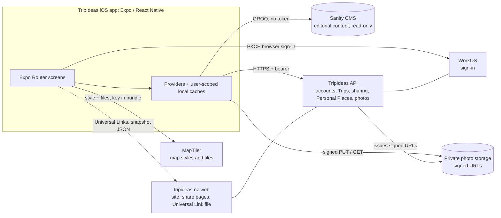

# TripIdeas Mobile: architecture

Status: describes the code at `release/shared-trips-mobile-rc2` (`d7bef7d`, TestFlight build 28). The code is the source of truth: where this document and the code disagree, the code wins and this document is wrong. Facts that cannot be read from this repository are marked **(not verified here)**.

Related: [README](../README.md) · [development guidelines](development-guidelines.md) · [UI/UX style guide](mobile-ui-ux-style-guide.md) · [release configuration](release-configuration.md) · [technical handover for Anu](mobile-web-api-handover.md) · shared API contract: `../tripideas-architecture/architecture/shared-database-schema-discipline.md`.

## 1. System at a glance

| Concern | Owner | Mobile's role |
|---|---|---|
| Editorial content (Places, Regions, Activities, pages, Privacy Policy) | Sanity CMS, shared with the website | Reads it directly; never writes |
| Accounts, Favourites, Trips, sharing, Personal Places, photo metadata | TripIdeas API and its database | Authenticated client; keeps user-scoped offline caches |
| Private photo bytes | Object storage behind the API | Uploads and reads only through short-lived signed URLs the API issues |
| Sign-in | WorkOS, brokered by the API | Runs a PKCE browser flow and stores only a refresh token |
| Map styles and tiles | MapTiler | Loads styles with a key that ships inside the app |
| Shared Trip links, Universal Link association file, snapshot pages | Website | Opens links in the app; reads snapshot JSON |

## 2. Application structure

- **Framework:** Expo SDK 54 (`expo ~54`), React Native 0.81, React 19, New Architecture enabled, TypeScript. Read the versioned Expo docs before changing anything Expo-specific (see `AGENTS.md`).
- **Navigation:** Expo Router, file-based, under `app/`. Five tabs in `app/(tabs)/`: Discover, Search, Saved, Map, Profile. Detail screens live in the root stack (`app/_layout.tsx`): `place/[slug]`, `trips/[tripId]`, `personal-place-cards/[cardId]`, `shared-trips/[collectionId]`, `collections/[collectionId]` (opened from a share link), `trip/[shareId]` (older public snapshot link), `privacy-policy`.
- **Feature flags:** `config/personal-content-features.ts` turns Personal Places on and **Notebooks and Diaries off**. Their code, routes and API clients are present but guarded, and they are not part of the current release.
- **Providers** (`app/_layout.tsx`, outermost first): `AuthProvider` → `SavedPlacesProvider` → `NotebookProvider` → `PersonalPlaceCardProvider` → `MyTripsProvider` → `DiaryProvider`. Each feature owns its provider, its API client, its storage and its tests (`auth/`, `saved/`, `trips/`, `shared-trips/`, `personal-place-cards/`, `photo-uploads/`, ...).
- **Shared UI:** `components/ui/` (buttons, chips, segmented control, headers, status text), `constants/design.ts` (tokens). See the [style guide](mobile-ui-ux-style-guide.md).
- **Tests:** plain Node tests, run with `node --loader ./scripts/test-loader.mjs --test <files>`; 105 `*.test.js` files at `d7bef7d`. Many UI tests assert on source structure (regular expressions over `.tsx`) or use `components/render-harness.js`, so they prove wiring, not pixels. There is no end-to-end suite in this repository.

## 3. Editorial data (Sanity)

`sanity/client.ts` creates a read-only client (public project and dataset, CDN on, **no token**). GROQ queries live in `sanity/queries.ts` and `sanity/place-cards.ts`; `sanity/types.ts` types the results. The app has no mobile-only content store. Trips and Favourites store Place **ids**; cards and images are fetched from Sanity by id when displayed. If the website changes a document shape, the mobile queries are affected: treat Sanity schema changes as cross-repository changes.

## 4. API responsibilities and data ownership

The API (`EXPO_PUBLIC_API_URL`, see [release configuration](release-configuration.md)) owns accounts and every user-authored record. The app talks to it through `lib/api-client.ts`:

- `apiFetch` for public calls, `authenticatedApiFetch` for signed-in calls (bearer token, one refresh-and-replay on `401`, then the session ends).
- **Routes used by mobile** (from the client code, not from API source): `/favourite`; `/itinerary` (+ `/entries`, `/entry`, `/import`, `/{id}/share`) for Trips; `/shared-trips`, `/favourites-collection/*`, `/collection-comments`, `/collection-item-comments`, `/collections/{id}/preview` for sharing; `/personal-place-cards` (+ `/media`); `/photo-assets/upload-intents`, `/upload-completion`, `/read-authorization`; `/auth/mobile/{authorize,exchange,refresh}`; `/version` for compatibility.
- **Compatibility:** `lib/api-compatibility.ts` reads `/version` (build, environment, capabilities). Per the shared contract a bare route `404` means "this environment lacks the capability", never "your content was deleted"; unreachable is not incompatible, and offline caches are kept.
- **Server data is authoritative** for Trips (capability `trip-api-authority`). Older device-only Trips are imported once through `/itinerary/import` (`trips/migration.ts`), with a journal so a retry never duplicates.
- **No defaults:** `EXPO_PUBLIC_API_URL` and `EXPO_PUBLIC_TRIP_SHARE_API_URL` are required (`config/required-env.ts`); if one is missing the app stops at startup with an error naming it, and it never falls back to production. The public-sharing gate opens only for the exact production API URL. The one soft spot is the map: a missing `EXPO_PUBLIC_MAP_STYLE_URL` yields `key=MISSING_KEY` (blank maps), and release builds are checked for the approved key. Variables per environment: [release configuration](release-configuration.md) section 12.

## 5. Authentication and sessions

Verified in `auth/`:

1. The app calls `POST /auth/mobile/authorize` with a PKCE challenge and state, opens the returned URL in the system authentication browser (`expo-web-browser`), and receives `tripideas://auth/callback`.
2. It exchanges the code and verifier at `/auth/mobile/exchange`. The verifier and expected state are kept in SecureStore only for that exchange.
3. **Stored:** the refresh token and the user summary, in `expo-secure-store`. **Not stored:** the access token, which lives in memory (`setActiveToken`).
4. On launch the app restores the session with `/auth/mobile/refresh`. Network or 5xx failures are retryable and keep the stored token; a rejected token ends the session.
5. **Sign-out is local only** (`POST /auth/mobile/logout` is not implemented). It clears the tokens, the active token and the private in-memory state, cancels that user's photo uploads and clears the user's caches, but the hosted WorkOS/Google browser session survives, so the next sign-in returns to the same account without choosing one. A product decision (see [product decisions](product-decisions.md)) kept the standard sign-in browser rather than an ephemeral session.
6. Sign-in uses the standard WorkOS session in every build; there is no mobile account switcher.

## 6. Account isolation

User data is partitioned by the internal user id wherever it is stored:

| Data | Where | Key |
|---|---|---|
| Trips cache, import journal, tombstones | AsyncStorage | `tripideas.trips.user.<id>.v…` and siblings |
| Personal Place cards | AsyncStorage | `tripideas.personalPlaceCards.user.<id>.v1` |
| Shared Trips cache | AsyncStorage | `tripideas.sharedTrips.cache.v1.<id>` |
| Photo upload queue | AsyncStorage | per-user queue (`photo-uploads/`) |
| Photo image cache identity | `expo-image` cache | `tripideas:personal-photo:v1:<userId>:<photoAssetId>` |
| Signed photo URLs and failures | memory only | cleared on user change |
| Saved (Favourite) ids | AsyncStorage | anonymous list plus per-user list; unioned with the server on sign-in (`saved/sync.ts`) |

Providers clear and re-key their state when the user changes, and in-flight responses that belong to a previous identity are discarded (for example `photo-authorizer.ts`). Tests cover the sign-out and account-change races for Trips, and the photo authoriser and loader tests cover clearing and cross-account isolation; Saved and Personal Place sign-out coverage is thinner (see the register's P0-02). Account switching is not offered in the UI.

## 7. Maps and geographic services

- **Rendering:** `@maplibre/maplibre-react-native` (ten importers; `react-native-maps` is listed as a dependency but is not imported by `app/`, `components/` or `location/`).
- **Styles:** MapTiler `streets-v2` and `satellite`, built in `constants/map.ts` from `EXPO_PUBLIC_MAP_STYLE_URL`. **The key is inside the style URL and ships in the app bundle**; restrict it at MapTiler (quota, referrer) rather than hiding it. Never print it in logs or documents.
- **Location:** foreground-only (`expo-location`, `location/`), with a usage string in `app.json`. The Map keeps filters and camera across navigation; Regions and Activities use the shared filter sheet (`components/map/filter-sheet.tsx`).
- Place data on the map comes from Sanity; the Map is also used by Trips and Personal Place location pickers.

## 8. Personal Places and private photos

**Records.** A Personal Place is an API record (`/personal-place-cards`) with title, body (autosaved, 650 ms debounce), optional location, and ordered media. It is private to the account, cached per user for offline reading, and can be added to the owner's Trips. Personal Places cannot be shared live (the API answers `personal_places_not_shareable`; the app explains it).

**Uploading** (`photo-uploads/`, [photo-upload-transport.md](photo-upload-transport.md)): select → validate (type, size, SHA-256) → upload intent → signed `PUT` of the managed local file → completion. A per-user AsyncStorage queue survives restarts; retries reuse a stable `clientRequestId`; signed URLs are never persisted.

**Reading** (`personal-place-cards/`):

| Piece | Behaviour |
|---|---|
| `photo-authorizer.ts` | Provider-wide in-memory cache of signed read URLs. A URL is fresh until 30 s before its expiry; concurrent requests share one call; `peek(id)` returns a fresh URL synchronously and never fetches; `clear()` (user change) drops everything and discards late responses. The server lifetime defaults to 300 s (API setting `PHOTO_STORAGE_DOWNLOAD_URL_TTL_SECONDS`, allowed 30–900; the deployed value is **not verified here**). |
| `photo-loader.ts` | Per-screen state per asset: `loading`, `ready`, `failed`. An asset already authorised starts `ready` with no `loading` state. Image errors and authorisation failures retry automatically a bounded number of times (1 s then 3 s; the editor allows one), then show a retry state. Exhausted photos are remembered for 60 s per user. Only the assets a screen lists are authorised (cards authorise at most four). |
| `use-personal-photos.ts` | The hook screens use. On first render it returns a cached `ready` state from the authoriser, so revisiting a Place shows its photos at once; it never starts a request while rendering. |
| Cache identity | Stable `expo-image` `cacheKey` per user and asset, never the signed URL, so URL refreshes do not re-download or remount images. |
| Rendering | Personal Place photos render with **no fade-in** (`transition 0`), recognised by their cache key (`isPersonalPhotoCacheKey`); editorial and other images keep a 150 ms fade. |

History worth knowing: photo flicker was first fixed in `4acff79` (stable keys, shared authoriser, bounded retry), reduced further by `b919ff9` (cached authorisation on first render) and `1906716` (no fade). Any change to image keys, `transition`, or the authoriser needs the matching tests in `personal-place-cards/photo-loader.test.js` and `components/personal-photo-render.test.js`.

## 9. Trips and sharing

**Trips.** Trips are API records (`/itinerary`) with entries that are either editorial Places or Personal Places. `trips/provider.tsx` is the single writer; it caches per user, reconciles stale refreshes, and keeps deletion tombstones so a deleted Trip does not reappear. Trip names, notes and entry notes autosave.

**Two different ways to share** (both reached from the Trip's Share menu, `app/trips/[tripId].tsx`):

| | Share live | Share a copy |
|---|---|---|
| What the recipient gets | A link to the owner's **live** Trip. They preview it, then deliberately **Join Trip** (follow it, add their own notes) or **Save a Copy**. | A separate copy of the Trip. |
| Backing | API collection with a capability token: `https://<web host>/collections/fc_…?k=<token>`; `shared-trips/` | Older public snapshot (`trips/public-sharing.ts` to the web's `/api/trips/share`); **only enabled when the app points at the production API**, otherwise the native share sheet carries text |
| Personal Places | Not allowed (`personal_places_not_shareable`) | Snapshot excludes them (the app refuses and explains) |
| Revocation | **Stop sharing** invalidates the link for new people; existing members, notes and Places stay | None (a snapshot is a public document) |

**Permissions (enforced by the API, not the app; exercised in the staging acceptance with two accounts):** the owner edits Places, sharing and their notes; a participant reads the Trip, adds, edits and deletes only their own notes, and can Leave; anonymous holders of the link can read the preview only. Opening a link never joins or saves anything: Join and Save a Copy are explicit taps that survive sign-in (`shared-trips/preview-actions.ts`). A copy takes only the creator's notes and is independent of its source.

**Links.** `app.json` associates `applinks:www.tripideas.nz`; integration builds (`APP_VARIANT=integration`, `app.config.js`) also associate `applinks:staging.tripideas.nz`. The association file is served by the **website**. Links must be tapped (Messages, Notes, Mail); typing one into Safari's address bar will not open the app.

**Privacy rules to preserve:** the link token is a capability (read and join), never an identity or user id; Personal Places and their photos stay private to their owner; per-user caches are cleared and re-keyed on sign-out; a copy never reveals other participants' notes.

## 10. Known gaps (as of `d7bef7d`)

- Sign-out is local-only and there is no account switching (section 5).
- The map falls back to a placeholder key when its style is missing (blank maps, no data risk); production builds are not yet gated on the EAS worker, so a production build lacking its variables would stop at launch (section 4; [release configuration](release-configuration.md) section 12).
- No in-app account deletion or Terms of Use ([release issue register](release-issue-register.md), P0-10, historical but still relevant).
- Older public snapshot sharing includes Trip and Place notes (register P0-04/P0-14a, owner decision needed); live sharing is the supported path.
- The map's name pop-up is not exposed to VoiceOver (iOS MapLibre limitation); the selected thumbnail offers the same action.
- Acceptance so far is Simulator plus TestFlight on one phone: see the handover for what still needs physical-device and production verification.
