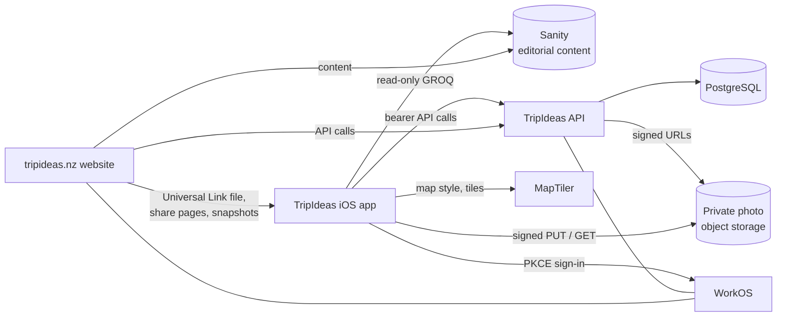

# TripIdeas mobile, web and API: technical briefing for Anu

Prepared 2026-11-01 for the production release owner. Mobile commit `d7bef7d` (branch `release/shared-trips-mobile-rc2`, TestFlight build 28, integration environment). No credentials or secret values appear in this document.

**This is a briefing, not a statement that production is ready. It is not.** Every production-side item below is unverified unless it says otherwise.

How to read the labels:

| Label | Meaning |
|---|---|
| **[V]** | Verified in the mobile code at `d7bef7d` (this repository) |
| **[R]** | From the release records kept during the Shared Trips work (acceptance on the integration environment, 2026-10-29 to 2026-11-01). True when recorded; **not re-checked for this document** |
| **[?]** | Assumption or needs your confirmation |

The API and web repositories were **not** inspected for this document. Statements about them come from the mobile client code and from [R]. More detail: [architecture](architecture.md), [release configuration](release-configuration.md), [development guidelines](development-guidelines.md).

## 1. System architecture and responsibilities

| Component | Responsibility | Repository |
|---|---|---|
| Mobile app | Expo / React Native iOS client; offline, user-scoped caches | `tripideas-mobile` |
| API | Accounts, Favourites, Trips (`/itinerary`), sharing collections, Personal Places, photo assets and signed URLs, mobile auth | `tripideas-api` (schema and migrations are canonical in `tripideas-api/prisma`) |
| Website | Public site, shared Trip pages (`/collections/fc_…?k=`), snapshot route, Universal Link association file | `tripideas-web` |
| Sanity | Editorial content shared by web and mobile | `tripideas-cms` |
| Architecture | Cross-repo policy, including the shared database discipline | `tripideas-architecture` |

The Planner (services and its own database) is **not** part of this release **[R]**.

## 2. How mobile uses the existing editorial content

- **[V]** The app reads Sanity directly with a read-only client (public project and dataset, CDN, no token): `sanity/client.ts`, `sanity/queries.ts`, `sanity/place-cards.ts`. It has no mobile-only content store.
- **[V]** Favourites, Trips and Personal Place Trip entries store editorial **Place ids**; the app fetches the cards from Sanity by id when it displays them.
- **[V]** Every build, including integration and TestFlight builds, reads the **production Sanity dataset**; there is no separate editorial staging.
- **[?]** Risk: a Sanity schema or document-shape change made for the website can break mobile queries. There is no contract test between them. Please confirm how schema changes are announced.

## 3. How mobile integrates with the API

- **[V]** Base URL from `EXPO_PUBLIC_API_URL`, **required: no default.** If it is missing, blank or not an http(s) URL the app stops at startup with an error naming the variable (`config/required-env.ts`); it no longer falls back to production. The same holds for `EXPO_PUBLIC_TRIP_SHARE_API_URL`. Per-environment values: [release configuration](release-configuration.md) section 12.
- **[V]** Signed-in calls use a bearer access token (kept in memory), refresh once on `401` and replay once, then end the session.
- **[V]** Routes the mobile client calls (read from the client code, so they are the routes production must serve):
  - Accounts and saved: `/auth/mobile/authorize`, `/auth/mobile/exchange`, `/auth/mobile/refresh`, `/favourite`
  - Trips: `/itinerary`, `/itinerary/{id}`, `/itinerary/{id}/entry` and `/entries`, `/itinerary/entries`, `/itinerary/import`
  - Sharing: `/itinerary/{id}/share`, `/shared-trips`, `/shared-trips/{id}`, `/favourites-collection/share`, `/favourites-collection/{id}/share-link` (POST, DELETE), `/favourites-collection/exit`, `/collections/{id}/preview?k=`, `/collection-comments`, `/collection-item-comments`
  - Personal Places and photos: `/personal-place-cards` (+ `/media`, `/media/order`), `/photo-assets/upload-intents`, `/photo-assets/{id}/upload-completion`, `/photo-assets/{id}/read-authorization`
  - Identity: `/version`
- **[V]** Compatibility: the app reads `/version` and expects `apiVersion: 1` and capabilities including `personal-place-cards`, `photo-assets`, `mixed-itineraries` and `trip-api-authority` (full list in `lib/api-compatibility.ts`); it also checks single capabilities for sharing and import before offering them. A route `404` is treated as "this environment lacks the capability", per the shared contract. **[?]** Please confirm production exposes `/version` with these capabilities.
- **[V]** Offline: Trips, Personal Places and the Shared Trips list are cached per user and stay readable when the API is unreachable.

## 4. Services shared with the website

- **Sanity content** **[V]** (section 2).
- **Accounts and sign-in** **[R]**: web and mobile use the same API and WorkOS user identity; web uses a session cookie, mobile uses tokens. Users are looked up by WorkOS id.
- **Shared Trip pages** **[R]**: the website serves the anonymous read-only page, Join Trip and Save a Copy (through the normal login with a `resume` continuation), and the Universal Link association file. The same collection, comment and share-link API routes serve both clients.
- **MapTiler** **[V]**: the style key is documented in `constants/map.ts` as shared with the website.
- **Database** **[R]**: independently deployed API services in one environment share one database; the shared-schema discipline applies (`../tripideas-architecture/architecture/shared-database-schema-discipline.md`): additive migrations only, `prisma migrate deploy`, never `db push` on a shared environment.
- **Older snapshot route** **[V]** (client side): `https://<web>/api/trips/share` and `/trip/<id>` links. The app can still create these only when pointed at the production API; they exclude Personal Places and include Trip and Place notes. **[?]** Do you want this path kept once live sharing is released?

## 5. Authentication and Universal Links

**Sign-in [V]:** `POST /auth/mobile/authorize` returns an authorisation URL for a PKCE challenge and state → the system authentication browser → callback `tripideas://auth/callback` → `POST /auth/mobile/exchange` with the code verifier → access and refresh tokens. The refresh token and user summary are kept in the iOS Keychain (`expo-secure-store`); restore on launch uses `/auth/mobile/refresh`.

**Known limits [V]:** sign-out is local only (`/auth/mobile/logout` is not implemented), so the hosted WorkOS/Google session persists and the same account signs straight back in. By product decision the standard sign-in browser is used. No account switching in the app.

**Server dependency [R]:** in the API repository, `src/app/auth/mobile-exchange.ts` calls `authenticateWithCodeAndVerifier`, which does not exist in `@workos-inc/node` 7.41.0. Mobile sign-in needs 7.74.1 or newer; the release candidate pins exactly 7.74.1. **At the time it was recorded, mobile sign-in was broken on the legacy staging build, which pins 7.41.0; check what production pins.**

**WorkOS applications [V, from `config/release-endpoints.js` as audited 2026-10-29]:** integration and production use different WorkOS clients (IDs are listed in [release configuration](release-configuration.md) section 2). The mobile callback is the same constant in both.

**Universal Links:**

- **[V]** The app is associated with `applinks:www.tripideas.nz`; integration builds (`APP_VARIANT=integration`) add `applinks:staging.tripideas.nz`. Bundle id `nz.tripideas.app`, team `AX2S87Y7LD`.
- **[R]** The association file is served by the **website** and needs the website's `APPLE_TEAM_ID` set. Staging serves it (HTTP 200 JSON, `appID` `AX2S87Y7LD.nz.tripideas.app`, component `/collections/fc_<26>?k=<43>`). **`www.tripideas.nz` returned 404 for it (2026-10-31): Universal Links will not work in production until the website release sets `APPLE_TEAM_ID`.** **[?]** Re-check live.
- **[R]** Not tested on a physical iPhone yet. A link must be **tapped** (Messages, Notes, Mail); typing it into Safari's address bar never opens the app.

## 6. Personal Places and photo storage

- **[V]** A Personal Place is an API record (`/personal-place-cards`) private to the account, with ordered media. Personal Places cannot be shared live (`personal_places_not_shareable`).
- **[V]** Upload: the app asks for an upload intent, does a signed `PUT` of the file (with SHA-256, size and MIME validated), then calls upload-completion. Records survive restarts in a per-user queue; retries reuse a client request id; signed URLs are never persisted.
- **[V]** Read: the app requests `read-authorization` per photo and gets a short-lived signed URL. It caches it in memory until 30 s before expiry and displays through a stable per-user, per-asset `expo-image` cache key, so URL refreshes do not re-download. Signed URLs and photo state are cleared on sign-out or account change.
- **[V, read from API config earlier]** The signed download URL lifetime defaults to 300 s (`PHOTO_STORAGE_DOWNLOAD_URL_TTL_SECONDS`, 30–900). **[?]** The value deployed on integration and the value intended for production are not verified. A short lifetime means more authorisation calls; a very long one weakens privacy.
- **[R]** Integration has its own private bucket and credentials, set on the integration API only; production and legacy staging keep their own. Photo-storage settings are validated at API startup.
- **[?]** Please confirm production photo storage (bucket, CORS/signing, credentials, lifetime) is configured and separate from integration. Whether removal of a Personal Place deletes its objects (and the retention for unsynced local files after sign-out) is a deferred decision.

## 7. Trips and sharing

- **[V]** Trips are API records; the server is authoritative. Old device-only Trips are imported once through `/itinerary/import` with a journal that prevents duplicates.
- **[V]** The Share menu offers **Share live** (a link to the owner's live Trip) and **Share a copy** (a separate Trip; see the snapshot note in section 4).
- **[V]/[R]** Live sharing: the link is `https://<web host>/collections/fc_…?k=<token>`. The token is a capability to read and join, not an identity. Opening a link only previews; **Join Trip** and **Save a Copy** are explicit taps. **Stop sharing** invalidates the link for new people; members, notes and Places stay; sharing again issues a new link.
- **[R]** Permissions are enforced by the API: owners edit Places, sharing and their notes; participants read, and add, edit and delete only their own notes, and can Leave; anonymous holders read the preview only; other people's note delete requests are refused (400, fixed in the API release candidate). A copy takes only the creator's notes.
- **[R]** Migration `20261031000000_fav_collection_link_sharing` adds two nullable columns and a unique index (additive; no migrations came from your staging commits).
- **[R]** Verified on integration with two accounts in the Simulator and web (Chrome, Safari private): creation, anonymous view, Join, notes, Leave, Save a Copy, Stop sharing and rotation, unauthorised email recipients rejected. Not verified: Save a Copy exclusion of other participants' notes (needs a third account; unit-tested only), real iPhone.
- **[R]** The session cookie is third-party for `staging.tripideas.nz` on the Railway API domain, so Safari may drop it; production's `api.tripideas.nz` is same-site.

## 8. Staging versus production

| | Local development | Integration (TestFlight builds 25 to 28) | Legacy staging | Production |
|---|---|---|---|---|
| Mobile API URL | `.env.local`; **production if unset** | `https://tripideas-api-integration-staging.up.railway.app` **[V]** | Not used by mobile builds **[V]** | `https://api.tripideas.nz` (the `production` profile sets nothing in `eas.json`; the EAS `production` environment supplies it) **[R]** |
| Website | n/a | `https://staging.tripideas.nz` (share snapshots `…/api/trips/share`) **[V]** | n/a | `https://www.tripideas.nz` |
| Database | n/a | Own database, API role without schema rights **[R]** | Database A (your `api` service) | Database B |
| Photo storage | n/a | Own private bucket **[R]** | Its own | Its own **[?]** |
| WorkOS | n/a | Integration client | n/a | Production client |
| Editorial content | Sanity production dataset | Sanity production dataset **[V]** | | Sanity production dataset |
| App associated domains | n/a | `www.tripideas.nz` and `staging.tripideas.nz` **[V]** | n/a | `www.tripideas.nz` only **[V]** |
| EAS | `expo start` | profiles `development`, `preview`, `testflight-staging` (`APP_VARIANT=integration`) | n/a | profile `production`, EAS environment `production` |

The integration API must never be reconnected to production or legacy-staging data **[R]**. Planner services and database are excluded **[R]**.

## 9. Deployment dependencies and compatibility risks

1. **Ship API, web and mobile together [R].** Enforcement is server-side; older web and mobile read collections by id and break against it. There is no dual period and no safe API-only rollback.
2. **Production is behind integration [R, 2026-10-29].** Production API lacked `/version`, `/itinerary/import` and `/auth/mobile/authorize`; production web lacked the snapshot route and the association file. **[?]** Re-verify live before planning.
3. **WorkOS SDK** pin (section 5).
4. **API startup needs `RESEND_API_KEY` [R]** (the mailer builds its client at import). Production currently has Gmail variables only; no DMARC record exists for `tripideas.nz`.
5. **Required API settings for production [R]:** `COLLECTION_SHARE_TOKEN_KEY` (32+ random characters, unique to production), correct `HOST` and `WEB_HOST`, `SHARE_CAPABILITY_VERIFIER_KEY` (and version) if notebook sharing is used, photo-storage settings, `APPLE_TEAM_ID=AX2S87Y7LD` on the website. Leave `SHARE_EMAIL_ALLOWED_RECIPIENTS` unset unless deliberate; set it on integration only.
6. **Unauthenticated admin write routes [R]:** `/admin/bookit/*` and `/admin/sanity/remove-walk-forest-tags` have no authentication. They are disabled by default in the release candidate (`ADMIN_SYNC_ROUTES_ENABLED`), **present and live on legacy staging** (with an Editor token on the production dataset), and must not be enabled in production. Authenticate or remove them.
7. **Migration ledger [R]:** run the ledger comparison before release; production does not have `20261031000000`, and holds integration-era rows and roles listed in the release plan (a separate reconciliation workstream).
8. **Place pages returned HTTP 500 on staging [R]** for every Place (ISR plus an uncached fetch); fixed in the web candidate with `dynamic = "force-dynamic"` and needs your review.
9. **MapTiler key ships in the app [V]:** confirm quota and restrictions. A build without the key has blank maps. `validate:release` and `verify:bundle` now check the key's format and SHA-256 against the approved fingerprint and reject a missing, malformed or unapproved key for TestFlight and App Store builds; the live MapTiler probe is a warning only. Rotation procedure: [release configuration](release-configuration.md) section 9.
10. **Configuration fails loudly [V]:** the silent production defaults are removed (API and share URL required; public sharing is enabled only for the exact production API URL), and the EAS worker now validates production builds as it does TestFlight builds (enabled 2026-11-02): a missing or wrong API or share URL, a set `APP_VARIANT` or an unapproved map key fails the build before it compiles. The real `production` EAS environment passes. **Not yet seen on a real production build**; keep that environment complete.
11. **Shared EAS `preview` environment [V]:** other mobile branches' TestFlight profiles use it; the Shared Trips profile no longer defines the share URL there (removed 2026-10-29 with rollback recorded). Do not change it without checking them.
12. **Submission profile [V]:** `eas.json` has no `submit.testflight-staging` or production App Store Connect app id; submission has needed a temporary configuration (section 8 of the release doc).
13. **Mobile gaps [V]:** local-only sign-out; no in-app account deletion or Terms of Use; the older snapshot share includes notes; `supportsTablet` is true with no iPad acceptance.
14. **Acceptance gap [R]:** all functional acceptance is on integration in the Simulator, plus one iPhone for UI. No physical-device pass of sign-in, Universal Links, the real photo picker, or location prompts has been reported yet.

## 10. Production release checklist

Nothing here has been done for production.

- [ ] Owner confirms physical-device acceptance of the current TestFlight build (sign-in and relaunch, Universal Link tap, Join/Leave, notes, Map, Personal Place photos with the real picker, Saved/Trips persistence). The owner has reported build 28 satisfactory for release preparation (2026-11-02); these specific checks are not individually recorded.
- [ ] Re-verify live production: API `/version` and routes in section 3, web snapshot and association routes, WorkOS configuration.
- [ ] Production environment configured (section 9 items 4 to 6): WorkOS SDK ≥ 7.74.1, `RESEND_API_KEY` and a verified sender (add DMARC), share token key, hosts, photo storage, `APPLE_TEAM_ID`, admin routes off, no Sanity write token.
- [ ] Migration ledger compared; additive migration applied with `prisma migrate deploy`; production backup and restore position recorded.
- [ ] Release candidate branches and SHAs recorded for API, web and mobile (integration used API `release/shared-trips-rc2` `7e7df56` and web `release/shared-trips-web-rc2` `0c2d89d` **[R]**); decide how they are merged and pushed (none has been pushed).
- [ ] Deploy API, then web (association file now 200), in one window, with rollback deployments recorded; smoke-test `/version`, a link preview, sign-in.
- [ ] Mobile: production EAS environment holds the production API URL, map style and share URL; build with the `production` profile from the approved commit; `validate:release --profile production --remote` (the worker repeats the check); `verify:bundle --variant production --ipa <file>`, which includes the MapTiler fingerprint; submit to App Store Connect.
- [ ] App Store requirements: Terms of Use, in-app account deletion, privacy answers, screenshots and listing, iPad decision.
- [ ] Post-release: Universal Link tap test on a phone against production; owner records which build is live.
- [ ] Rollback plan agreed (release configuration section 11).

## 11. Open questions for Anu

1. Does production expose `/version` with `apiVersion: 1` and the capabilities in section 3? Which build SHA is deployed on production API and web today?
2. Is the intended release path to merge the three release branches and deploy from GitHub, or CLI uploads as on integration? Who pushes, and to which branches (`staging`, `main`)?
3. Which WorkOS SDK version does production run, and will you adopt ≥ 7.74.1?
4. What is the production email provider plan (Resend sender, DMARC), and should `SHARE_EMAIL_ALLOWED_RECIPIENTS` stay unset?
5. Are the unauthenticated admin sync routes still live on legacy staging (with a production-dataset Editor token), and who owns removing them?
6. Is production photo storage configured (separate bucket, signing, TTL, CORS), and what is the intended download URL lifetime?
7. Who sets `APPLE_TEAM_ID` on the production website so the association file is served, and when?
8. Should the older public snapshot share remain (it includes notes) or be retired in favour of live sharing and copy?
9. What should sign-out do on production: keep local-only, or add WorkOS logout (API and tenant change) to allow account switching?
10. What are the MapTiler quota and key restrictions, who owns the key and its rotation (procedure in release configuration section 9; the website shares the key, so it must rotate with it), and should it be rotated now (it was printed once into a working session on 2026-11-01; recorded in the release notes)?
11. How are Sanity schema changes coordinated with the mobile queries?
12. What should happen to a Personal Place's stored photos when the place is deleted, and to unsynced files after sign-out?
13. What is the plan for production database reconciliation items (relinked accounts, extra role, public proxies, shared cookie password)? They are outside this release but block a clean production gate.
